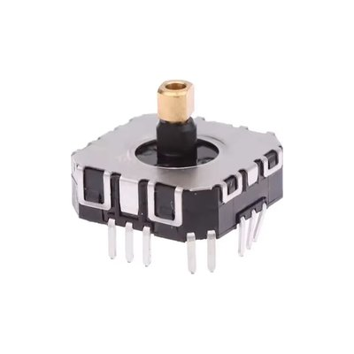
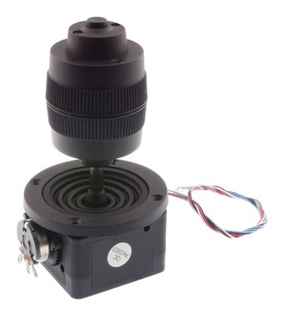

# JoystickUtilities

Read, calibrate and store analog thumb sticks, with direction keys for menus.

This library reads **physical joysticks** connected to a board. It does not make a board appear
to a PC as a USB game controller.

- **`AnalogAxis`** reads one potentiometer: averaged, optionally inverted, mapped to
  **−1000 … 1000** with a dead zone around the center and each half scaled separately to its
  calibrated end.
- **`Joystick<N>`** groups 1 to 6 axes, samples them once per `update()`, and can be switched
  off when a stick is not fitted.
- **Calibration building blocks**: `CenterSampler` averages the resting position,
  `RangeTracker` records the travel while the stick is swept, and every axis checks the result
  and reports whether it was accepted. The *procedure* - prompts, countdowns, buttons, a
  display - stays in your sketch.
- **`DirectionKeys`** turn a stick into up/down/left/right presses with auto-repeat, e.g. for
  menus.
- **`saveCalibration()` / `loadCalibration()`** store calibrations with Preferences (ESP32).

## Requirements

- **ESP32** boards with Arduino-ESP32 core **2.x or 3.x** (tested on the hardware below with
  **3.3.12** and **2.0.17**, and on a PC). The core of the library is plain C++ and
  board-independent; storing calibrations uses the ESP32's Preferences.
- **C++11** or later, so it also builds with the gnu++11 of Arduino-ESP32 2.x. Classic 8-bit
  AVR boards are not supported (no `<array>`).

No other library is needed.

## Tested hardware

| | FJ08K-S | JH-D400B-M4 |
|---|---|---|
| |  |  |
| **Type** | thumb stick, 2 × B10K potentiometer, push button | 4D joystick, 10 kΩ potentiometers, push button |
| **Axes** | 2 (X, Y) | 3 (X, Y, twist) |
| **Used in** | [VectorArcade](https://github.com/forgevolt/VectorArcade) | [Transmitter](https://github.com/forgevolt/Transmitter) |

Any stick with one potentiometer per axis works. The push buttons are ordinary switches and are
not read by this library.

## Installing

**Library Manager**: in the Arduino IDE, *Sketch → Include Library → Manage Libraries*, search for
`JoystickUtilities`, install.

**From this repository**: *Code → Download ZIP*, then *Sketch → Include Library → Add .ZIP
Library*.

## Using it

```cpp
#include <JoystickUtilities.h>
using namespace joystickutilities;

// X on GPIO 34, Y on GPIO 35 (inverted, so that pushing away reads positive)
Joystick<2> stick({ AnalogAxis(34), AnalogAxis(35, true) });

void setup()
{
  Serial.begin(115200);
  stick.begin();
  loadCalibration(stick, "Joystick");   // ESP32: use a stored calibration if there is one
}

void loop()
{
  stick.update();                        // sample once ...
  int x = stick.getX();                  // ... and read as often as you like
  int y = stick.getY();
  if (stick.isUp()) { /* menu up */ }
  delay(20);
}
```

`update()` samples every axis and advances the direction keys. Everything that reads the stick
until the next `update()` gets the same numbers, so a display and a radio link sending in the
same pass agree.

## Calibrating

A thumb stick rarely rests at the exact middle of the ADC range and rarely reaches both ends.
A calibration records, per axis, the raw value at rest (`center`) and at both ends (`min`,
`max`). The library provides the measuring; when each step starts and ends is up to you:

```cpp
CenterSampler<2> center;                  // 1. the stick is left alone
for (int i = 0; i < 200; i++) { center.add(stick); delay(5); }

RangeTracker<2> range(center.center());   // 2. the user sweeps every axis to its ends
while (/* not done */) { range.add(stick); delay(5); }

auto result = stick.setCalibration(range.calibration());   // 3. apply and check
if (!result.allAccepted()) { /* tell the user which axis was not moved */ }
saveCalibration(stick, "Joystick");      // ESP32
```

**Measuring the center.** A sprung stick does not come back to exactly the same spot: where it
rests depends on the direction it was released from. Measured on a JH-D400B-M4, the rest
positions of one axis spread over about 50 counts. A center taken from a single rest can sit
at the edge of that spread, and the dead zone then has to cover all of it. Averaging several
releases from different directions puts the center in the middle - `CenterSampler` simply keeps
adding across them, as the SerialCalibration example does.

**The check.** A calibration is accepted when both halves of the travel clear the dead zone
with room to spare: `min + 2·deadzone < center` and `center + 2·deadzone < max`. Anything less
would map to a stuck full deflection - an axis that was not moved during the sweep is the
typical case. A rejected axis keeps working with the full ADC range, and `result.accepted[i]`
says which one it was.

`RangeTracker` exposes `min(i)`, `max(i)` and `center(i)` while the sweep runs, so a display
can show how much of the travel has been covered.

The **SerialCalibration** example does all of this through the Serial Monitor, one Enter per
step. A sketch with a display can drive the same blocks with a countdown and a button.

## Settings

Each axis takes an `AnalogConfig`; the defaults suit an ESP32 with a typical thumb stick:

| Setting | Default | Meaning |
|---|---|---|
| `adcMax` | 4095 | highest raw value (12-bit ADC) |
| `deadzone` | 50 | raw counts around the center that read as 0 (about 1.2 % of the range) |
| `samples` | 4 | readings averaged per read |

```cpp
AnalogConfig config;
config.deadzone = 80;
Joystick<2> stick({ AnalogAxis(34, false, config), AnalogAxis(35, true, config) });
```

A fourth argument replaces `analogRead()`, e.g. for an external ADC or a multiplexer:

```cpp
int readAds(uint8_t channel) { return ads.readADC_SingleEnded(channel); }
AnalogAxis x(0, false, config, readAds);
```

**Direction keys** take a `DirectionConfig` as the second argument of `Joystick`: a key becomes
active above `onThreshold` (500) and is released below `offThreshold` (300); held, it repeats
after `repeatDelayMs` (1500) every `repeatIntervalMs` (300). Positive y is up, positive x is
right.

## Storing calibrations (ESP32)

`saveCalibration(stick, ns)` writes `min`, `center` and `max` of every axis to the Preferences
namespace `ns`, with keys `minX`, `centerX`, `maxX`, `minY`, … (`X`, `Y`, `Z`, `U`, `V`, `W` for axes
0–5). Use one namespace per stick, at most 15 characters.

`loadCalibration(stick, ns)` opens the namespace read-only - a stick that was never calibrated
leaves the flash untouched - and returns `false` if nothing was stored. A stored calibration
goes through the same check as a new one; an optional third argument receives the result.

## Switching a stick off

A two-stick device built with one stick can keep the same code: `stick.setActive(false)` makes
it report 0 everywhere without touching the ADC, and the calibration blocks ignore it.
`loadCalibration()` still loads it, so switching it on later finds its calibration.

## Examples

| Example | Shows |
|---|---|
| ReadJoystick | reading a two-axis stick |
| SerialCalibration | a complete calibration through the Serial Monitor, stored and loaded again |
| DirectionKeys | the stick as four arrow keys with auto-repeat |

## Tests

`make -C test` builds the library on a PC against a small Arduino stand-in and runs the checks,
among them every raw value against 280 calibrations (1,146,880 combinations).
`make -C test examples` also builds and runs every example; `STD=c++11` builds as C++11, the
standard of Arduino-ESP32 2.x.

## Origin

The library grew out of the joystick code of two projects:
[Transmitter](https://github.com/forgevolt/Transmitter) (two 3-axis sticks) and
[VectorArcade](https://github.com/forgevolt/VectorArcade) (one 2-axis stick). It was extracted
from both with the help of Claude, which compared the two implementations, drafted the API and 
wrote the code, tests and examples. Every file was reviewed and approved by the author.

## License

MIT, see [LICENSE](LICENSE).
